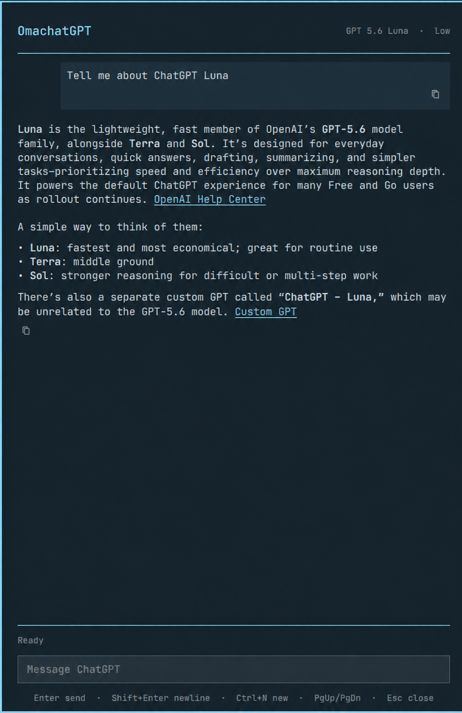

# OmachatGPT



OmachatGPT is a small, keyboard-first quick-chat panel and status-bar widget for
Omarchy: summon it, chat with **OpenAI** (via your existing local Codex CLI
login) and **open-weight models on OpenRouter** from a single unified model
picker, and return to what you were doing without opening a browser or a full
coding-agent interface.

It uses the locally installed Codex CLI (`codex login`) for OpenAI models and
optional OpenRouter credentials configured in Settings, with zero runtime npm
dependencies.

## Features

- **Unified Model Picker (OpenAI + OpenRouter)**
  - **OpenAI**: Uses your local `codex login` session (`gpt-6-luna` default when
    available) with hosted live web search—no OpenAI API key required.
  - **OpenRouter**: Optionally add an OpenRouter API key in **Settings (`Ctrl+,`)**
    to chat with fast, personable open-weight models alongside OpenAI, or run
    standalone with OpenRouter alone.
  - **Curated Open-Weight Defaults**: Ships with **DeepSeek V4.1 Flash**,
    **Mistral Large 4**, **Qwen 3.8 Flash**, **Kimi K3**, **GLM 5.3 FlashX**,
    **Gemma 4 26B A4B**, and **DeepSeek V4 Pro**—customizable directly in
    Settings (`slug` or `slug | Display Name`).
  - **Seamless Mid-Chat Switching**: Switch between OpenAI and OpenRouter models
    inside the same conversation without losing context.
- **Native Omarchy Bar Icon & Quattro Panel**
  - Includes a status-bar icon (`BarWidget.qml`) that opens a pull-down menu to
    select **Open Chat / Hide Chat**, **New Chat**, or **Settings…**.
  - Warm backend for immediate reopen during short breaks.
  - Resumable conversation owned separately from normal Codex sessions, with
    automatic conversation naming from the first prompt.
- **On-Demand Web Search & Formatting**
  - Hosted live web search on OpenAI models and on-demand OpenRouter web search
    (`plugins: [{ id: "web" }]`) with clickable Markdown source citations.
  - Streaming prose with formatted links, lists, emphasis, code blocks, and
    readable Unicode math normalization.
  - Expandable multiline composer and one-click message or code copying.
  - Deliberately no command execution, file access, plugins, skills, images, or
    coding-agent workflow.

## Requirements

- Omarchy 4.0 or newer with Quattro shell plugin support
- Node.js 20 or newer on `PATH`
- At least one model provider:
  - **OpenAI via Codex CLI**: A current Codex CLI with `app-server` support and
    a ChatGPT-authenticated Codex login (`codex login status`), **and/or**
  - **OpenRouter**: An API key from [openrouter.ai](https://openrouter.ai),
    configured in **OmachatGPT Settings (`Ctrl+,`)**.

Omarchy supplies the shell APIs and `omarchy-launch-browser` helper used by the
panel.

## Install

```bash
omarchy plugin add https://github.com/dpellerin/OmachatGPT.git --enable
omarchy-shell shell toggle dpellerin.omachatgpt '{}'
```

The plugin defaults to `Option+Space` (`ALT + SPACE` in `~/.config/hypr/bindings.lua`)
and includes a **Global shortcut** recorder in **Settings (`Ctrl+,`)** to change
it at any time.

Update or remove it with Omarchy's standard plugin commands:

```bash
omarchy plugin update dpellerin.omachatgpt
omarchy plugin remove dpellerin.omachatgpt
```

Removing the plugin leaves its local state files and the conversation owned by
Codex intact. To remove OmachatGPT's local state and OpenRouter configuration
after uninstalling, run:

```bash
rm -f "${XDG_STATE_HOME:-$HOME/.local/state}/omachatgpt/state.json" \
      "${XDG_STATE_HOME:-$HOME/.local/state}/omachatgpt/openrouter.json" \
      "${XDG_STATE_HOME:-$HOME/.local/state}/omachatgpt/shortcut.json"
rmdir "${XDG_STATE_HOME:-$HOME/.local/state}/omachatgpt" 2>/dev/null || true
```

## Configuring OpenRouter & Shortcut

1. Open OmachatGPT and press **`Ctrl+,`** (or click the bar icon and select
   **Settings…**, or choose **Configure OpenRouter in Settings…** from the
   header model menu).
2. Paste your OpenRouter API key (`sk-or-v1-...`) using the **Paste** button or
   keyboard paste and click **Save Key**.
3. Customize the open-source model list if desired:
  - Add any OpenRouter model slug (`provider/model-name` or
    `provider/model-name | Custom Name`).
  - Remove models you don't use with **×**, or click **Reset Defaults** at any
    time.
4. Pick any model under the **OpenAI** or **OpenRouter** section of the header
   menu.

## Keys & Bar Actions

- `Enter`: send
- `Shift+Enter`: insert a newline
- `Esc`: close open popup/settings, stop an active response, or close the panel
- `Ctrl+N`: start a new chat (keeps selected model)
- `Ctrl+,`: toggle Settings
- `PageUp` / `PageDown`: scroll
- **Bar Icon**: Opens a pull-down menu for **Open Chat / Hide Chat**, **New
  Chat**, and **Settings…**

## Scope and safety

The Node bridge launches `codex app-server` with an empty, private runtime
directory (`0700`), an allowlisted environment, a read-only sandbox, approvals
disabled, MCP servers cleared, and all local-action features disabled.
OpenAI-hosted web search (and OpenRouter's web search plugin for OpenRouter
models) is the only tool exposed to the conversational model. Unexpected
command, file-change, browser-control, MCP, image, or agent events are
interrupted and reported.

Links are restricted to `http` and `https` output and open through Omarchy's
browser launcher. Assistant HTML is escaped before display. Clipboard copying
uses Quickshell's native clipboard API, so message text is not placed in a
process argument or passed through a shell.

Like every Omarchy shell plugin, `Panel.qml` and `BarWidget.qml` run unsandboxed
inside the long-lived `omarchy-shell` process. Review third-party plugin source
before enabling it. Marketplace validation is not a security audit.

## What it runs and writes

| Component | Purpose | Access and persistence |
| --- | --- | --- |
| `Panel.qml` / `BarWidget.qml` | Renders the Quattro panel, settings view, and bar icon | Runs inside `omarchy-shell`, as do all shell plugins. |
| `codex app-server --stdio` | Provides authenticated OpenAI conversation streaming and live web search | Runs as a child process with a private temporary working directory, allowlisted environment, read-only sandbox, approvals disabled, MCP cleared, and local-action features disabled. |
| `https://openrouter.ai/api/v1/chat/completions` | Streams optional OpenRouter responses and on-demand web search | Used only when an OpenRouter model is selected and an OpenRouter API key is configured. |
| `omarchy-launch-browser` | Opens assistant links after an explicit click | Receives only validated `http` or `https` URLs. |
| `$XDG_STATE_HOME/omachatgpt/state.json` | Resumes the most recent OmachatGPT chat | Stores the thread ID, selected model, synced message transcript, and update timestamp with owner-only permissions (`0600`). |
| `$XDG_STATE_HOME/omachatgpt/openrouter.json` | Stores optional OpenRouter settings | Stores the configured OpenRouter API key and custom model list with owner-only permissions (`0600`). |
| `$XDG_STATE_HOME/omachatgpt/shortcut.json` | Stores the configured global shortcut | Stores the user's preferred shortcut binding (`0600`) and updates the OmachatGPT entry in `~/.config/hypr/bindings.lua` when changed in Settings. |

## Data and privacy

OmachatGPT writes private state files under:

```text
$XDG_STATE_HOME/omachatgpt/state.json
$XDG_STATE_HOME/omachatgpt/openrouter.json
$XDG_STATE_HOME/omachatgpt/shortcut.json
```

The fallback directory is `~/.local/state/omachatgpt/`, created with mode `0700`
and files with mode `0600`. Ambient environment variables and OpenRouter keys are
never passed into the Codex subprocess environment.

## Limitations

- This is a focused text chat, not a replacement for ChatGPT or Codex.
- Images, attachments, voice, local files, and system context are unsupported.
- Math rendering is a lightweight readable formatter, not a complete TeX
  engine.
- Codex's experimental app-server protocol may require compatibility updates in
  future Codex releases.

## Development

Install the development tools and run the complete local verification suite:

```bash
pnpm install --frozen-lockfile
pnpm verify
pnpm smoke
```

`pnpm smoke` makes a real model request and uses account quota. The other checks
are local. The repository commits `dist/` because Omarchy's plugin installer
only clones and validates a plugin; it never runs package-manager or build
hooks.

For local development, link the checkout into the supported user plugin
directory:

```bash
ln -s "$PWD" ~/.config/omarchy/plugins/dpellerin.omachatgpt
omarchy-shell shell rescanPlugins
omarchy plugin enable dpellerin.omachatgpt --section right
omarchy-shell shell toggle dpellerin.omachatgpt '{}'
```

The panel exposes non-sensitive latency counters for development checks:

```bash
omarchy-shell shell call dpellerin.omachatgpt metrics '{}'
```

## License

MIT
